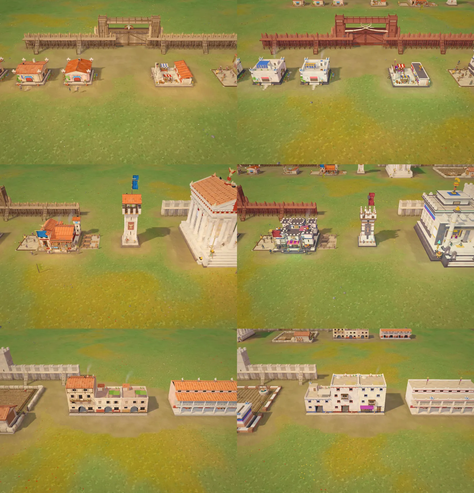
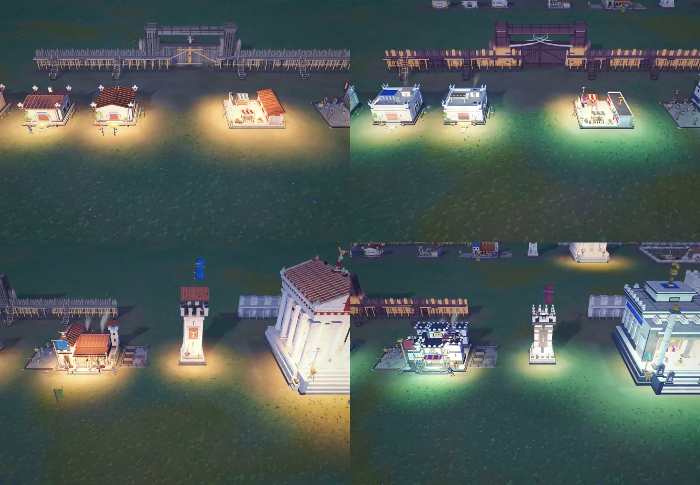
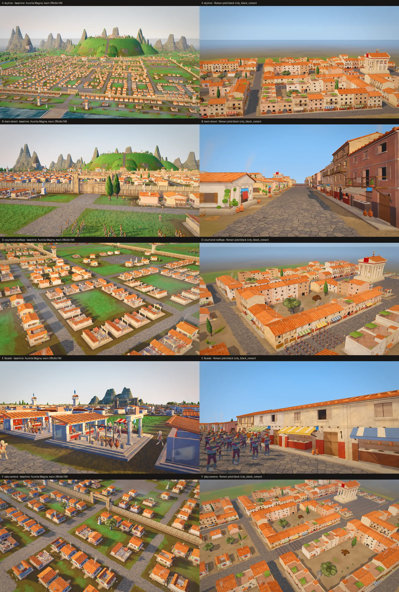
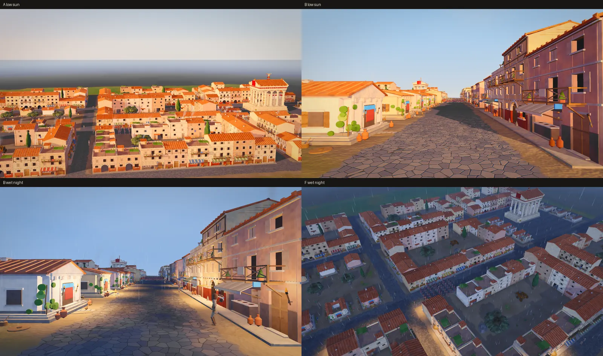
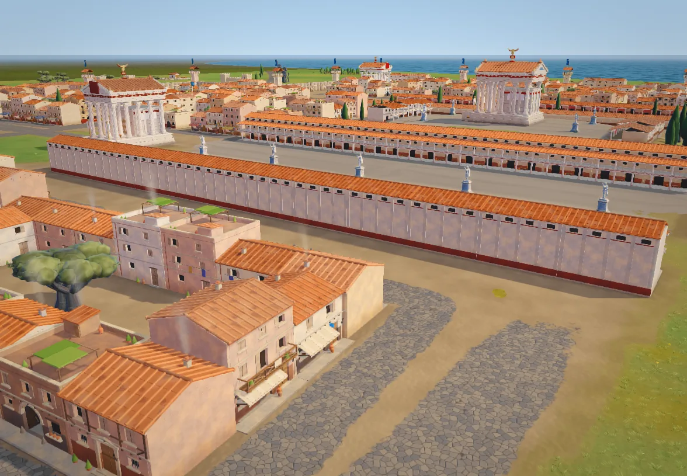
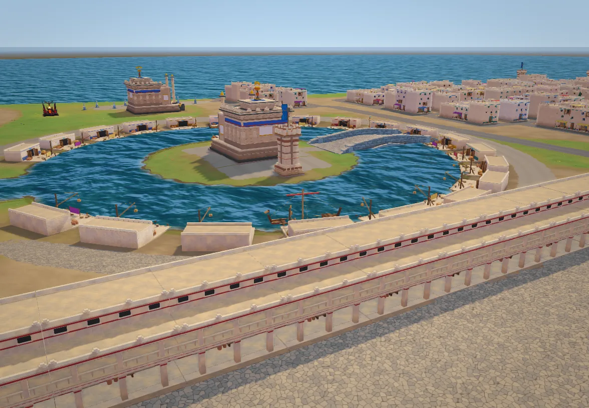
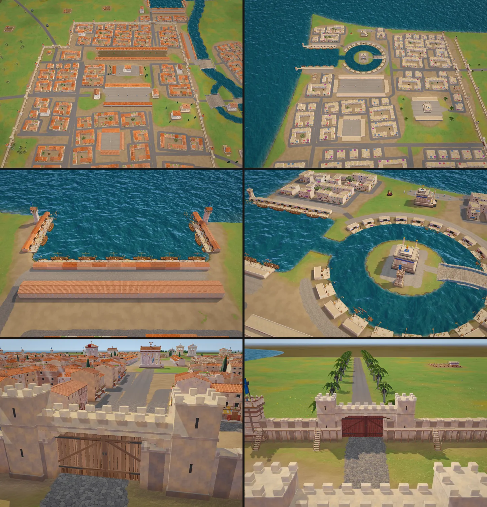

# City Visual Direction

How Roman and Carthaginian cities in Standard of Iron are meant to look, how that
is judged, and where the work stands. This is the art direction and review
contract for issue #1683. It owns the visual rules, the frozen review views, the
defect rubric and the measured baseline; the map, bake and render pipelines keep
their own documents (`MAP_GENERATOR.md`, `BAKED_MESHES.md`,
`RENDERING_ARCHITECTURE.md`, `PROMO_CAPTURE.md`).

## 1. What a city has to do

A city is read at three distances, and it has to work at all three with the same
geometry and the same light:

| Band           | Camera                    | What must read                                                        |
| -------------- | ------------------------- | --------------------------------------------------------------------- |
| Far, 100-300 m | aerial approach, map zoom | skyline, district pattern, wall line, one or two landmarks            |
| Mid, 30-100 m  | ordinary play             | rooflines, eaves, street walls, courts, where the doors and shops are |
| Near, 2-30 m   | commander view, film      | openings with depth, thresholds, sills, shutters, wares, wear         |

The order of work follows the bands: silhouette first, then roof and street-wall
rhythm, then surface. A detail that cannot be seen from the play camera is never
a reason to skip a silhouette problem.

A city is not a set of good buildings. The baseline (section 7) had good
buildings and still read as a holiday village: the failure was in how they
stood together. Composition rules therefore come before building rules.

## 2. Reference set

No photographs, scans or third-party artwork are used, stored or traced. The
reference set is:

1. **Written archaeology.** What is generally known of the building types the
   two cultures left: the insulae, tabernae and paved streets of Ostia, Pompeii
   and Herculaneum; the courtyard houses, cisterns and stepped streets of
   Punic Kerkouane and the Byrsa quarter of Carthage. These are described in
   words in sections 4 and 5; nothing is copied from a publication.
2. **In-engine reference boards.** Raw captures of our own scenarios at the six
   frozen views, kept under `artifacts/city-review/` with their manifests. The
   committed excerpts are in `docs/screenshots/city/`.
3. **Plan diagrams.** The block and lot diagrams in this document.

Anything added later has to be original or carry a licence that allows it, and
has to be listed here.

## 3. Rules common to both cultures

### Composition

- **Streets have walls.** In a built-up quarter the houses stand wall to wall on
  the street line. A gap between two town houses is an alley with a purpose, not
  leftover lawn.
- **Blocks have an inside.** A block is a ring of houses around a court. The
  court is beaten earth with a tree, a cart, washing; it is where the back doors
  are.
- **Height is grouped, then varied.** Storeys come from a coarse district cell
  first and only then stray by one, so a street shows runs of similar height
  with the odd taller or lower house, never a random sawtooth.
- **Landmarks are few and on an axis.** A temple, a gate or a tower closes a
  street or crowns a rise. Ordinary buildings never out-climb the landmark that
  a view is composed on.
- **Density falls away outward.** Core: three and four storeys, shops, paving.
  Ring: two storeys, yards. Fringe: garden houses, orchards, fields. A town does
  not end at a ruler line with lawn on both sides.
- **Ground follows use.** Paving on the main streets and the forum, beaten earth
  in lanes and courts, grass only where nobody walks.

### Palette and material

| Material           | Albedo range (linear, approx.)      | Response                                            | Never                                 |
| ------------------ | ----------------------------------- | --------------------------------------------------- | ------------------------------------- |
| Limewash / plaster | 0.55-0.80, warm; ochre, cream, rose | matte, soft mottling, damp line at the foot         | pure white, grey, saturated primaries |
| Stone trim         | 0.45-0.70, warm grey                | matte, bevelled edges catch light                   | mirror-clean blocks                   |
| Roof tile          | 0.35-0.55, red-orange to brown      | matte, course and cover-tile relief, per-house tone | one flat orange sheet                 |
| Timber             | 0.15-0.35                           | grain along the member, dark in recesses            | yellow planks                         |
| Cloth              | 0.35-0.70, dyed                     | matte, striped or plain, one accent per house       | neon, glossy                          |
| Paving             | 0.35-0.50                           | joints readable near, uniform far                   | noise that shimmers in motion         |
| Beaten earth       | 0.30-0.45, pale dusty brown         | darker where damp or rutted                         | lawn green inside a town              |

Team colour is an accent only (a shop sign, a lintel tablet, a standard). A wall
is never team coloured.

### Light

- A wall the sun does not reach is lit by the sunlit street and the houses
  opposite, not only by the sky. Shaded plaster is a warm grey; it does not go
  slate blue.
- Openings are darker than the wall they are cut in at every hour. Depth comes
  from real recesses, never from a dark rectangle painted on a flat box.
- The same scene has to hold at midday, at low sun and on a wet night without a
  per-shot exposure or grade.

### What is not acceptable

Scored with the rubric in section 6. The standing list:

- buildings floating above or sunk into sloping ground;
- flush coloured boxes standing in for doors, windows or mouldings;
- coincident surfaces that flicker;
- a block whose houses all share one height, roof and colour;
- the same building repeated side by side;
- team-coloured or primary-coloured walls;
- lawn between town houses; streets with no edge;
- decoration that blocks a door, a gate, a road or a siege approach;
- anything visible through fog of war that the player has not seen.

## 4. Roman grammar

**City form.** A grid of streets with a wider main street; rectangular blocks;
a paved forum on the main axis with the temple closing one end; walls and gates
that read from the air as one line.

**Housing, core: the insula** (`"style": "tenement"` on a `home`, section 8).
Two to four storeys of limewashed brick on a single lot, party walls shared with
the neighbours.

```
   street
 ============================  pavement, 0.5 m, laid by each house
 [shop ][door][shop ][arch ][shop ]   <- south terrace, fronts on the street
 [     ]                    [     ]
 [ w   ]      court         [  e  ]   <- side terraces
 [     ]   tree, cart       [     ]
 [shop ][shop ] alley [door ][shop ]  <- north terrace, one lot left open
 ============================
   street
```

- Street storey: a wide shop opening with a masonry counter and sunken storage
  jars, a timber lintel and a striped awning; or a doorway with a stone
  surround and barred high windows; or a round-headed carriage passage with
  voussoirs and wheel guards.
- A painted dado along the street: Pompeian red, burnt ochre or umber, with the
  wash above it.
- Upper storeys: small shuttered windows set a hand deep in the wall, a stone
  sill and lintel each; string course at every floor; joist ends showing under
  the first floor; a timber balcony on brackets on some houses; a timber-framed
  top storey on others.
- Roof: a low gable parallel to the street, tegulae in overlapping courses,
  a cover tile over every joint, an antefix at each eave end, a ridge. Some
  houses carry a walled roof terrace with a vine pergola instead.
- Court side: back door, fewer windows, a rain pipe, firewood under a tiled
  canopy, washing strung from the first floor.

**Housing, ring and fringe: the garden house** (the plain `home`). One storey,
porch columns, tiled gable or a compluvium, a yard with its oven, jars and hens.
It keeps its place outside the dense core and in villages.

**Public buildings.** Temple on a podium with a columned porch; market halls
with stalls; barracks around a drill yard; stone-and-timber walls with square
towers.

**Planting.** Cypress as a marker beside a temple or a gate; an olive or two in
a court; pots on balconies and terraces. No palms.

**What every Roman building carries** (`render/entity/nation_motifs.h`). Rome is
warm stone, ochre wash and oxblood on a foot of dark tufa, and its marks are the
same from a farm to a temple:

- a bronze tripod with a live fire at the door, the steps or the quay;
- a pale palmette on every eave corner and along every ridge;
- a raven on the roof, because Rome takes its omens from birds;
- outside anything a legion lives in, a trophy: taken arms hung on a trunk, the
  skull of the man who carried them at its foot;
- over a gate, an ox skull and a garland.

## 5. Punic grammar

**City form.** Denser and less regular than the Roman grid: narrow lanes that
step and turn, a market street as the spine, the harbour or the citadel as the
focus rather than a forum. Courts are inside the houses, not inside the blocks.

**Housing.** Cubic, flat-roofed, whitewashed over stone and rammed earth; tall
houses of several storeys in the core. The roof is used: parapets, awnings,
drying racks, a light well, a cistern head. Openings are few and small on the
street, a blue or red painted band at the door, a Tanit sign rather than a
pediment. Colour comes from cloth and paint on a white ground, where the Roman
street takes its colour from the wash itself.

**Public buildings.** The sanctuary with its precinct wall and stelae; the
bazaar; mercenary barracks with stepped merlons; walls in red-washed timber and
stone with banded towers.

**Planting.** Palm, pomegranate and fig; a potted cypress on a roof.

**What every Punic building carries.** Carthage is whitewash over black basalt,
banded in Egyptian blue and hung with purple:

- horns on the corners of every roof;
- a tall incense stand by the door, and what burns in it burns pale sea-green:
  at night a Punic street is lit a different colour from a Roman one;
- the disc and crescent of Baal on a pole over a market or a hall;
- stelae cut with the sign of Tanit at the foot of a tower, the gate of a
  barracks, the steps of a temple;
- ivory crossed over a gate; cedar beam ends under a parapet.

Motifs are baked into the building, set down on its own geometry
(`Motif::Setter`), and kept inside its collision body. A fire is a named part of
the mesh: the building library reads the names back (`RenderArchetype::fires`)
and whatever draws the building lights a live flame there, with its light.





The two cultures must be told apart with the interface off: by roofline (tile
gables against flat parapets), by wall colour (ochre washes against white), and
by plan (street grid against lanes).

## 6. Review method

### Six frozen views per city

| View | What it is                                 | Band     |
| ---- | ------------------------------------------ | -------- |
| A    | high skyline approach                      | far      |
| B    | main road or gate, at eye level            | near/mid |
| C    | civic street, forum or market              | mid      |
| D    | court and rooftops from above              | mid      |
| E    | one facade, close                          | near     |
| F    | ordinary play camera, troops in the street | mid      |

Each city also has a low-sun frame of two of its views and a wet-night pair
(views B and F), plus two clips: a walk along the main street and a flight in
from the skyline. That is the whole matrix; it is not multiplied by preset or
weather.

The views are Arena promo specs with world-space cameras:

| Spec                                                       | Scenario                 | Subject               |
| ---------------------------------------------------------- | ------------------------ | --------------------- |
| `tools/arena/promos/city_review/roman_block.json`          | `city_block_roman`       | Roman pilot block     |
| `tools/arena/promos/city_review/roman_block_motion.json`   | `city_block_roman`       | walk and flight clips |
| `tools/arena/promos/city_review/aurelia_magna.json`        | `promo_imperial_capital` | Roman flagship city   |
| `tools/arena/promos/city_review/aurelia_magna_motion.json` | `promo_imperial_capital` | walk and flight clips |
| `tools/arena/promos/city_review/punic_town.json`           | `carthage_trade_town`    | Punic showcase        |

Rome and Carthage are reviewed as whole maps: a views file names the shipped
map and one camera per view, and the capture is the map's own preview, with no
scenario in between.

| Views file                                           | Map                             |
| ---------------------------------------------------- | ------------------------------- |
| `tools/arena/promos/city_review/rome_views.json`     | `assets/maps/map_rome.json`     |
| `tools/arena/promos/city_review/carthage_views.json` | `assets/maps/map_carthage.json` |

### Capturing

```sh
scripts/city-review.py map tools/arena/promos/city_review/rome_views.json \
    --out artifacts/city-review/rome-<label>
scripts/city-review.py capture tools/arena/promos/city_review/roman_block.json \
    --out artifacts/city-review/roman_block-<label>
scripts/city-review.py compare artifacts/city-review/<before> \
    artifacts/city-review/<after> --out artifacts/city-review/pairs.jpg
scripts/city-review.py perf city_block_roman --out artifacts/city-review/perf
```

`capture` writes the raw frames (no grade, no edit), a contact sheet and a
`manifest.json` holding, per frame: scenario and seed, camera eye, look-at and
field of view, resolution, graphics preset, lighting hour, weather, build SHA
and whether the tree was dirty, and the CPU and GPU. Review frames are taken at
**High**, the preset the game is judged at. A before/after pair must share
scene, preset, resolution and machine; `--arena <binary>` runs a copy of
`arena_app` kept from before a change so both halves come from one tree.

`perf` runs the scenario with `--profile` and writes p50/p95/p99 frame time,
per-stage render CPU time, GPU time, draw calls, instances, a VRAM proxy
(cumulative buffer and texture allocation) and startup time. Wall clock on a shared desktop is
noisy; compare the minimum and the counters before trusting a percentile.

A reference frame is replaced only by a reviewed capture. Pixel difference
does not decide whether a frame is better.

### Severity rubric

| Severity     | Meaning                                                                                                                                          |
| ------------ | ------------------------------------------------------------------------------------------------------------------------------------------------ |
| **Critical** | The subject is not recognisable or is structurally broken: a city that does not read as a city, geometry missing or exploded.                    |
| **Major**    | Plastic material, obvious stacked primitives, floating or clipping structures, muddy or wrong-coloured light, repeated blocks, a broken skyline. |
| **Moderate** | A local shape or material problem, thin scene dressing.                                                                                          |
| **Minor**    | Polish.                                                                                                                                          |

Every defect is recorded against the views it shows in and the files that own
it, in `docs/city_review_audit.json`. `scripts/city-review.py audit
docs/city_review_audit.json --gate` lists what is open and fails while a
critical or major defect is. The issue closes only when that gate passes on the
stills and the clips for both cities.

## 7. Baseline

Captured at `3f9c9e196` (main before this work), High, 1920x1080, on the
reference machine in the manifests.

### What was wrong

See `docs/city_review_audit.json` for the full ranked list with owners. The
defects that decided the plan:

| Id   | Severity | Defect                                                                                      | Views         |
| ---- | -------- | ------------------------------------------------------------------------------------------- | ------------- |
| R-01 | Critical | Aurelia Magna reads as a grid of detached one-storey cottages on lawn; no street has a wall | A, D, F       |
| R-02 | Major    | Flat skyline: 583 homes of one height, nothing between a cottage and the temple             | A             |
| R-03 | Major    | Shaded walls turn slate blue                                                                | B, C, D, E, F |
| R-04 | Major    | Lawn between houses and in every court inside the walls                                     | D, F          |
| R-05 | Major    | An imperial capital behind a timber palisade                                                | A, B          |
| R-06 | Major    | Forum and plazas are bare grey rectangles                                                   | C             |
| R-07 | Major    | Basilica, curia, baths and library are market stalls                                        | C, E          |
| R-08 | Moderate | The sacred mountain is a smooth green dome; the crags are cones                             | A             |
| P-01 | Critical | There is no Punic city: the showcase is eight buildings in a stockade                       | A, D, F       |
| P-02 | Major    | The arena's banded cliff ring stands in for a horizon                                       | A, B, E       |
| P-03 | Moderate | Punic houses are well characterised but identical in height                                 | A, D          |

### What it cost

Measured with `scripts/city-review.py perf`; the numbers are in section 9 next to
the numbers after the Roman pilot.

## 8. How a city is authored

**Structures carry a style.** A `structures[]` entry in a map may name a
`"style"`. A style is presentation only: it selects a different renderer for the
structure and leaves its type, navigation footprint, collision body, health and
economy exactly as they were.

```json
{
    "type": "home",
    "x": 12.9,
    "z": -4.4,
    "rotation": 180,
    "player_id": 1,
    "nation": "roman_republic",
    "style": "tenement"
}
```

| Type           | Style      | What it draws                                                                            |
| -------------- | ---------- | ---------------------------------------------------------------------------------------- |
| `home`         | `tenement` | Town housing of two to four storeys on a 4.3-unit lot: the insula, the Punic tall house. |
| `marketplace`  | `portico`  | A colonnaded walk with shops behind it, on a 5.5-unit lot. A run of them is a stoa.      |
| `marketplace`  | `basilica` | A hall with a clerestory behind a two-storey colonnade: the long sides of a forum.       |
| `marketplace`  | `dock`     | A quay, its warehouse, a crane, and a ship, a boat or drying nets alongside.             |
| `wall_segment` | `masonry`  | A crenellated curtain of dressed stone where the nation's field wall is a palisade.      |
| `wall_gate`    | `masonry`  | Two stone towers and the wall carried over the passage, with timber leaves.              |

Every style exists for Rome and for Carthage. Known styles are listed in
`game/visuals/building_asset_key.h` (`k_building_visual_styles`). The map loader rejects a style it does not know;
a style a nation has no renderer for draws that nation's plain building. The
style travels map -> `StructureEntry::style` -> `SpawnParams::visual_style` ->
the `RenderableComponent` renderer key, which saves already persist.

**Tenements share lot geometry** (`render/entity/tenement_layout.h`). Side walls
stand on the edge of the home's navigation footprint, so two tenements on
neighbouring lots meet in a party wall and the block is exactly as solid to
path-finding as it looks. The variant a lot draws (storeys, street storey,
roof, balcony) is a pure function of its world position.

**A run is one building.** Porticoes and basilicas are placed lot by lot, but
every lot of a straight run stands on one line and faces one way, and that line
seeds the run (`lot_run_seed`, `render/entity/market_lot.h`): its wash, its
roof tone and its variant are the same from end to end, however long it is. A
dock's vessel is longer than its lot, so `dock_visual_variant` never moors a
ship at two neighbouring lots.

**A wall keeps its style.** A wall's renderer key is recomputed whenever its
neighbours change, so the style is stored on the structure
(`BuildingComponent::visual_style`, saved with it) and reapplied by the wall
network (`Game::Visuals::apply_wall_style`).

**The sea is a lake.** A harbour needs three things from the water:

- `"height": -0.6` on the lake, and on a river that runs into it: the water
  then lies half a unit below the ground and cuts a bank a quay can stand on.
  A dock stands with its centre 2.25 units inland of the water's edge.
- `"shape"`: `natural` is an ellipse with a wandering shore, for a coast;
  `basin` a rectangle with eased corners, for a harbour or a dock; `round` a
  true ellipse. A round harbour with an island is a ring river.
- Shallows that stay shallow: a lake wider than 68 units keeps its shore
  effects to a 20-unit strip, a basin or a round pool to four, and where one
  lake lies inside another there is no shore between them. Without this a
  sea-sized lake drew mud flats a bowshot wide.

Paving for a forum, an agora or a quay is the `flagstone` road style.

**A city is an operations file.** `map_cli new` writes a blank map and
`map_cli apply` builds the city on it from `tools/map_editor/plans/*.ops.json`
with the town operations in [MAP_REVIEW.md](MAP_REVIEW.md#building-a-town):
`terrace`, `block`, `paving`, `wall`, `gate`. The same operations are tools in
the editor (Insula, Town Block, Portico, Basilica, Dock). Both shipped cities
pass `map_cli audit` and round-trip through the editor byte for byte.

**Blocks are laid on the footprint.** `lay_tenement_block`
(`tools/arena/arena_city_block_scenarios.h`) lays the four terraces of a
perimeter block from the home footprint and leaves one lot open as the alley
into the court.

**Town ground is derived.** The terrain's cover mask already stamps a trodden
yard around every building. Where buildings crowd together their weights add up
and the ground between them becomes beaten earth
(`TerrainRenderer::stamp_building_ground`); nothing is authored per map, and a
dense AI-built town gets it as well.

**Simulation owns structures, terrain and obstacles.** Awnings, balconies,
pavement slabs, jars, pots and washing are baked into the building mesh or drawn
by its activity system; none of them is an entity and none of them blocks a
path. Nothing a tenement draws at walking height stands outside the lot.

## 9. Status and numbers

### Slices

| Slice                         | State                                                                                                                                      |
| ----------------------------- | ------------------------------------------------------------------------------------------------------------------------------------------ |
| 0. Art direction and baseline | Done: this document, the review specs, `scripts/city-review.py`, the baseline captures and numbers, `docs/city_review_audit.json`.         |
| 1. Roman pilot block          | Done: the insula (`"style": "tenement"`), `city_block_roman`, town ground, street bounce on shaded walls, four palette slots per building. |
| 2. Punic pilot block          | Done: the Punic tall house on the same style, lot geometry and shell as the insula.                                                        |
| 3. City integration           | Rome and Carthage done as new maps (below): civic styles, docks, masonry walls, harbours. Aurelia Magna itself is not converted yet.       |
| 4. Atmosphere and activity    | Open.                                                                                                                                      |
| 5. Optimisation and QA        | Open.                                                                                                                                      |

### Roman pilot block



The left column is Aurelia Magna on main; the right is `city_block_roman`. They
are **not the same scene**: the block is the pilot the issue asks for before any
citywide change, and Aurelia Magna itself is converted in slice 3. Until then
the flagship city only shows the changes that apply everywhere (town ground,
shaded walls, roof tone).



The same block at 17:48 and on a wet night at 21:30, no per-shot exposure.

### Rome and Carthage



`assets/maps/map_rome.json`, 801 units square. The Tiber comes in from the
north, swings west round the Campus Martius, splits about its island under the
Capitol and runs to the sea along the south edge, where Ostia stands. The
Servian wall follows the seven hills in angled runs, with its gates on the
straight legs. Inside it every quarter has its own warped street web and every
house is turned to its street; the Forum, the imperial fora, the Colosseum, the
Circus Maximus and the baths stand on their own axes. Gardens fill the courts
behind the street fronts and ring the city: the gardens of Sallust, Lucullus,
Maecenas and Caesar, the Campus Martius with the Pantheon, the theatre of
Pompey and the Mausoleum of Augustus, umbrella pines on the Janiculum,
Trastevere across the river, suburbs along the consular roads and tombs along
the Via Appia.



`assets/maps/map_carthage.json`, 801 units square, on a headland between the
gulf, the Lake of Tunis and the salt marsh. Its street pattern is deliberately
not Rome's: ring streets round the Byrsa, which rises in three steps to the
temple of Eshmun with a stair-street up its east face, and a fan of streets
running from it down to the sea, with narrow offset lanes from the agora to the
round war harbour. Megara, the garden suburb, fills the north inside its own
wall: villas round peristyle courts, orchards, palm-lined lanes, irrigation
channels between garden pools. A triple wall crosses the isthmus, a sea wall
runs along the coast in angled runs, and every wall ends in the water.



| Map      | Structures | Houses | Porticoes and basilicas | Docks | Temples | Wall runs, gates, towers | Trees and props |
| -------- | ---------- | ------ | ----------------------- | ----- | ------- | ------------------------ | --------------- |
| Rome     | 2324       | 1915   | 263                     | 27    | 17      | 43 runs, 9, 37           | 2243            |
| Carthage | 2688       | 2434   | 80                      | 35    | 5       | 57 runs, 8, 59           | 2378            |

The plans are generated (an organic layout library over the town operations:
warped lane webs, radial and ring streets, street fronts that follow a curve,
parks, court gardens) and written as `tools/map_editor/plans/*.ops.json`;
`map_cli apply` builds the map from that file alone. Rules the plans keep,
each learnt the hard way:

- The grid is odd (801). On an even grid whole-number coordinates fall on
  cell edges and every gatehouse's lane is shut by half a cell.
- A house turned to a curving street blocks its axis-aligned bounding box plus a
  metre of padding on the navigation grid, so houses stand 1.45 m back from the
  street edge; two rows turned 45 degrees still leave a lane.
- Where a street meets a stoa, the stoa piece it runs through is left out: the
  square gets an entrance there. No street may run into a temple, barracks or
  farm.
- Bridges are laid square to the river (the game refits them so on load) and
  their approach roads run onto the deck.
- Walls end in the water or at the map edge.

`tests/headless/city_map_passage_test.cpp` loads both maps into a live world
and marches troops through every gate and from the roads outside to the Forum
and the agora.

Both are player 1's city with its commander in the forum or agora, and a
besieging commander of the other nation outside the walls.

What the new buildings cost, in triangles at full detail, against what they
stand in for:

| Building              | Rome            | Carthage      | For comparison                 |
| --------------------- | --------------- | ------------- | ------------------------------ |
| Tenement (8 variants) | 7,168 - 14,024  | 5,744 - 9,504 | Roman home: 15,992 - 22,956    |
| Portico and basilica  | 6,940 - 10,140  | 2,040 - 2,816 | Roman marketplace: 50,288      |
| Dock, with its vessel | 10,132 - 13,716 | 5,796 - 9,392 |                                |
| Masonry wall segment  | 528 - 968       | 528 - 968     | Roman palisade segment: 3,472+ |
| Masonry gatehouse     | 2,212           | 2,212         | Roman timber gatehouse: 6,128  |

Whole-map frame time, measured with the arena map review
(`SOI_REVIEW_TIMING_FRAMES=200`, each frame drawn and read back, High, 1176x815,
RTX 5060 off-screen through VirtualGL), the 600-unit maps against these on one
build: at gameplay zoom Rome 11.0 ms both, Carthage 10.7 to 11.6 ms; at night
Rome 10.6 to 12.4 ms, Carthage 10.5 to 13.8 ms (more lights in view, and Punic
fixtures throw sea-green light a little further); a 330 m skyline view 12.5 to
16.8 ms and 11.6 to 17.7 ms, with about three times the buildings in frame.

### Numbers

Reference machine: Intel Core i7-12700KF, GeForce RTX 5060 (driver 590.48.01,
OpenGL 4.5), Linux. Arena batch, High, 1176x815 viewport, 60 fps fixed step,
12 s, first 60 frames dropped. Two runs each for the city; the range is given.

| Scene                                    | Build             | Frame p50 / p95 / p99 (ms)        | GPU colour p50 (ms) | Draw calls | Structures |
| ---------------------------------------- | ----------------- | --------------------------------- | ------------------- | ---------- | ---------- |
| Aurelia Magna (`promo_imperial_capital`) | baseline          | 20.4-20.6 / 22.0-22.5 / 32.4-32.8 | 18.8-18.9           | 9498       | 1028       |
| Aurelia Magna                            | this work         | 20.5 / 23.0-24.1 / 32.9           | 18.6-18.7           | 9498       | 1028       |
| Punic town (`carthage_trade_town`)       | baseline          | 1.38 / 1.81 / 2.12                | 5.18                | 1638       | 70         |
| Punic town                               | this work         | 1.35 / 1.73 / 2.01                | 5.21                | 1638       | 70         |
| Roman pilot block (`city_block_roman`)   | this work, High   | 1.50 / 2.05 / 2.67                | 5.33                | 1677       | 164        |
| Roman pilot block                        | this work, Medium | 1.28 / 1.78 / 2.25                | 3.52                | 1665       | 164        |
| Roman pilot block                        | this work, Low    | 1.38 / 1.93 / 2.37                | 2.45                | 1545       | 164        |

- Aurelia Magna is GPU bound at High and unchanged within run-to-run noise:
  the p95 of the two runs moved from 22.0-22.5 ms to 23.0-24.1 ms (under the
  10 % flag), the minimum frame from 18.1-18.3 ms to 18.2-18.8 ms, and draw
  calls, batches and rigged instances are identical.
- A tenement is lighter than the home it replaces: 7 200-14 000 triangles
  against 16 000-23 000 for the six Roman home variants, and one merged-mesh
  instance each.
- The building instance record grew from 96 to 128 bytes (two more palette
  slots); cumulative buffer allocation over a 12 s Aurelia run went from
  5 776 MB to 5 860 MB (+1.5 %).
- Medium and Low keep the block's structure: silhouettes, openings, awnings and
  street edges are all geometry. Low drops cast shadows; the shaded-wall fill
  still applies because it follows the surface's facing as well as the shadow
  map.

Not measured yet: OpenGL 3.3 and software-GL correctness for the new instance
layout (thirteen vertex attributes; the 3.3 minimum is sixteen), and startup
time (`scripts/city-review.py perf` records it from this change on).
